<!-- profile-contribution-banner:start -->
<picture>
  <source media="(prefers-color-scheme: dark)" srcset="./assets/contributions/banner-dark.svg">
  <source media="(prefers-color-scheme: light)" srcset="./assets/contributions/banner-light.svg">
  
</picture>
<!-- profile-contribution-banner:end -->
