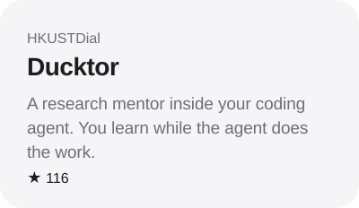
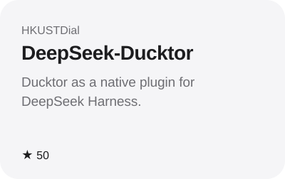
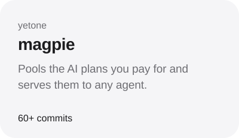
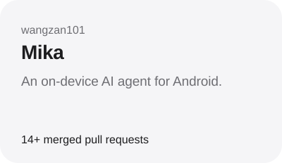
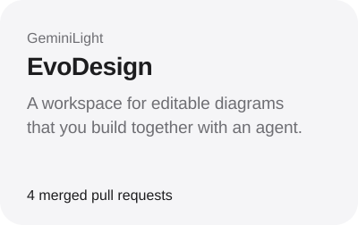

> Preview B: drawn cards. The lines in "Now", "Papers" and "Fun facts" are placeholders. They show the layout only.

  <picture>
    <source media="(prefers-color-scheme: dark)" srcset="../assets/title-dark.svg">
    <source media="(prefers-color-scheme: light)" srcset="../assets/title-light.svg">
    
  </picture>
  
<strong>Second-year PhD student. I build open-source tools for doing research with coding agents.</strong>

  

    <code>Intern at ByteDance (Frontier Tech Program)</code>
    <code>Based in Shanghai</code>
  

  
X: <a href="https://x.com/YinWU2001">@YinWU2001</a> · Open to internship opportunities

#### Now

- Placeholder: first thing you are working on.
- Placeholder: second thing you are working on.
- Placeholder: third thing you are working on.

#### Built

<a href="https://github.com/HKUSTDial/Supervisor-Skills"><picture><source media="(prefers-color-scheme: dark)" srcset="../assets/cards/supervisor-skills-dark.svg"></picture></a>
<a href="https://github.com/HKUSTDial/Ducktor"><picture><source media="(prefers-color-scheme: dark)" srcset="../assets/cards/ducktor-dark.svg"></picture></a>
<a href="https://github.com/HKUSTDial/DeepSeek-Ducktor"><picture><source media="(prefers-color-scheme: dark)" srcset="../assets/cards/deepseek-ducktor-dark.svg"></picture></a>

#### Contributed to

<a href="https://github.com/yetone/magpie/commits?author=yinwu01"><picture><source media="(prefers-color-scheme: dark)" srcset="../assets/cards/magpie-dark.svg"></picture></a>
<a href="https://github.com/wangzan101/Mika/pulls?q=is%3Apr+author%3Ayinwu01+is%3Amerged"><picture><source media="(prefers-color-scheme: dark)" srcset="../assets/cards/mika-dark.svg"></picture></a>
<a href="https://github.com/GeminiLight/EvoDesign/pulls?q=is%3Apr+author%3Ayinwu01+is%3Amerged"><picture><source media="(prefers-color-scheme: dark)" srcset="../assets/cards/evodesign-dark.svg"></picture></a>

#### Papers

- Placeholder: paper title. Venue, year. [paper](#) · [code](#)
- Placeholder: paper title. Venue, year. [paper](#) · [code](#)

#### Fun facts

- Placeholder: first fact.
- Placeholder: second fact.
